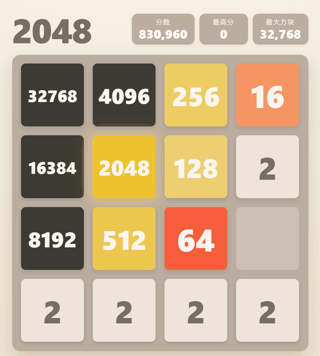
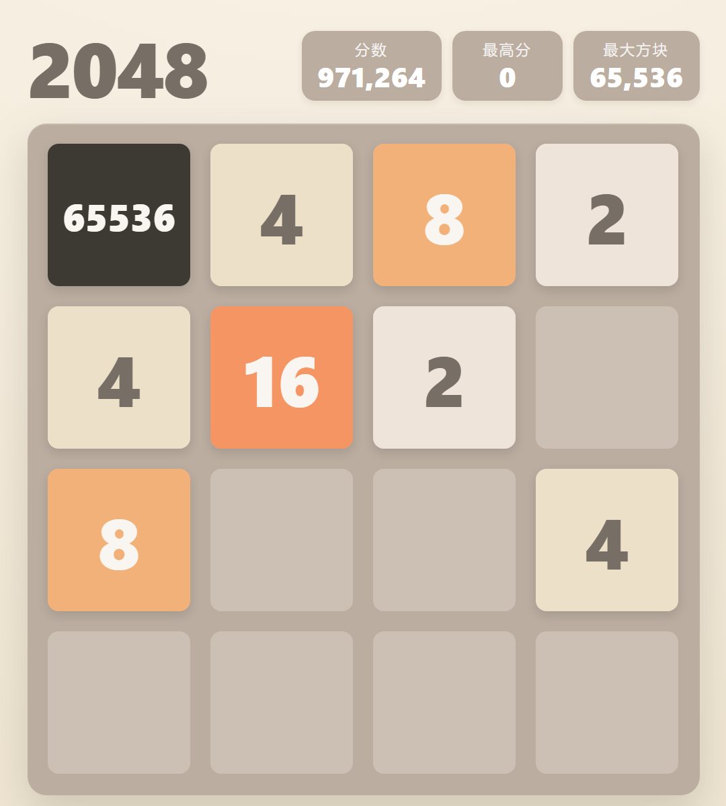

# 2048 AI Showcase

A local, browser-based 2048 auto-play showcase powered by the C++ Expectimax AI
from [macroxue/2048-ai](https://github.com/macroxue/2048-ai).

The browser owns the real game — board, moves, merges, spawning, score, and
replay. A dependency-free Node.js server serves the page and proxies move
requests to the AI running in Docker. The AI only suggests a move; it never
invents or edits the displayed game state.



*Real replay frames from the archived seed-411789 game (steps 29,323–29,883,
shown at about 10 fps). The 65536 tile first appears at step 29,823.*

## Highlights

- **Real 2048 rules** in the browser: 4×4 board, one merge per move, and one
  spawned tile per valid move (90% / 10% for 2 / 4).
- **C++ Expectimax AI** with Tuple10/Tuple11 lookup tables, running locally in
  Docker at search depth 3.
- **Strictly serial AI playback**: request → move → spawn → animate → verify
  DOM → wait. No hundreds-of-moves-per-second visual updates.
- **Replay viewer**: import a version-1 JSON replay, open at the final board,
  seek, step, play, pause, and change speed without calling the AI.
- **Background tooling**: unit and Headless Edge tests, batch benchmarks, JSON
  replay export, and a resumable parallel 65536 challenge.
- **No neural network or reinforcement-learning model.** The move policy is
  Expectimax over the real game tree with precomputed tuple tables.

## Real 65536 result

| Metric | Value |
|--------|-------|
| Seed | **411789** |
| Final score | **1,148,460** |
| Max tile | **65536** |
| Full game length | **37,257** moves |
| Total attempts | **56** games |
| First 65536 | Step **29,823** |



*The first 65536 state from the real archived replay. The score at this moment
is 971,264; the game continued to 1,148,460 and ended naturally.*

The complete replay is tracked in Git:

- [`archives/challenge-65536/game-053-seed-411789.json`](archives/challenge-65536/game-053-seed-411789.json)
- [Provenance, checksums, and final board](archives/challenge-65536/README.md)

The original copy remains in `reports/challenge-65536/` and is intentionally
ignored by Git. The archived replay reconstructs to the recorded final board,
score, max tile, and step count, and passes Headless Edge import/seeking.

## How it works

```text
Browser
  index.html / style.css / main.js / game.js / replay.js / ai-client.js
        |
        |  GET /move?board=<16 tile ranks>
        v
  serve.js (Node.js, port 8000)
        |  static whitelist + same-origin proxy
        v
  Docker container 2048-ai (port 8080)
        |  Expectimax, depth 3, Tuple10/Tuple11 tables
```

- Board encoding: row-major ranks, `0` empty, `1`=2, `2`=4, …, `15`=32768,
  `G`=65536.
- AI replies: `u` / `l` / `r` / `d`, or `g` for game over.
- The browser applies the move and performs exactly one spawn; all scores are
  produced by the real web game.
- Replay files contain the initial board, every move direction, every spawned
  tile position/value, and the final score/max tile. The final board is rebuilt
  from those records during import.

## Quick start

### Requirements

- Docker Desktop (Windows/macOS) or Docker Engine (Linux)
- Node.js (tested with Node 24; no npm dependencies)
- Microsoft Edge only for the optional Headless browser tests

The first AI start needs about **5 GB RAM** and **3 GB disk** for generated
lookup tables. Table generation takes roughly 4–8 minutes on the first run.
Later starts reuse `vendor/2048-ai/tables/`.

### Windows

```powershell
powershell -ExecutionPolicy Bypass -File scripts\start.ps1
```

The script starts Docker if needed, builds the small AI image, starts the
container on port 8080, generates the tables on first use, starts the page
server, and opens <http://localhost:8000>.

For background/manual startup without opening a browser:

```powershell
powershell -ExecutionPolicy Bypass -File scripts\start.ps1 -NoBrowser
```

Stop the local services with:

```powershell
powershell -ExecutionPolicy Bypass -File scripts\stop-ai.ps1
```

### Manual commands

```bash
docker build -t 2048-ai-small vendor/2048-ai
docker run -d --name 2048-ai -p 8080:8080 \
  -v "$PWD/vendor/2048-ai/tables:/data" 2048-ai-small
node serve.js
```

Open <http://localhost:8000>. If the AI service is unavailable, the page shows
an explicit connection error and retries; it does not silently fall back to a
weaker AI.

## Using the showcase

- Click **AI 开始** to start auto-play.
- Playback speeds: **3 / 5 / 8 / 12 / 20 moves per second** (default 8).
- **AI 暂停** stops before the next step; **AI 继续** resumes the same game.
- Game over keeps the final board and shows the final score, max tile, and move
  count. **下一局** starts a new game.
- **自动连续挑战** is off by default; when enabled, it waits about 3.5 seconds
  and starts the next game, capped at 500 games per session.
- Achievements at 32768 and 65536 are stored in browser localStorage.

### View the archived 65536 replay

1. Start the page (the `-NoBrowser` option is fine).
2. Open <http://localhost:8000>.
3. Click **导入回放**.
4. Choose `archives/challenge-65536/game-053-seed-411789.json`.

The replay opens at its final board. Use the controls to go to the start, seek,
play, pause, or inspect the first 65536 at step 29,823.

## Tests

```bash
node test.js
node scripts/browser-test.js
node scripts/test-all.js
```

- `node test.js`: 25 unit tests covering rules, spawn behavior, AI protocol,
  static server/proxy, replay validation/seeking, and the abortable benchmark
  loop. No Docker required.
- `node scripts/test-all.js`: unit tests followed by a Headless Edge test.
  Edge and the local AI service are required.
- Browser tests never open a visible window by default; `--visible` is opt-in.
- A real replay can be validated in Headless Edge:

```bash
node scripts/browser-test.js --replay=archives/challenge-65536/game-053-seed-411789.json
```

The archived replay was verified with 37,257 moves and the recorded final score,
max tile, and board.

## Batch benchmark

```bash
node scripts/ai-benchmark.js --games 10 --seed 7
node scripts/ai-benchmark.js --games 100 --out reports/run-100
```

- Default is **1 game**; long runs are never started automatically.
- Reuses `game.js` and the same local `/move` endpoint, with no browser or DOM.
- Writes JSON/CSV summaries under `reports/` (Git-ignored).
- Exports a complete replay for every game to `reports/replays/`, with
  collision-safe filenames and full score/max/step metadata.
- The engine/proxy has exceeded 1,000 moves/s in headless runs; the web UI is
  deliberately capped at 20 moves/s for readable serial playback.

## 65536 challenge

```bash
# Start or resume the default challenge
node scripts/challenge-65536.js

# A separate challenge with another state file and seed
node scripts/challenge-65536.js \
  --state reports/challenge-65536/run-2.json --seed 7
```

- Default concurrency is **2** (1–4 allowed), chosen to avoid contention in the
  shared C++ lookup tables.
- A game succeeds only after reaching 65536 **and** ending naturally. It keeps
  playing after 65536 until Game Over; truncation is not success.
- State/report: `reports/challenge-65536/state.json`, updated after each game.
  Ctrl+C saves progress; rerun the same command to resume without repeating
  completed indices.
- Unsuccessful games store only compact statistics. On success, the full replay
  is verified and saved; existing files are never deleted.
- For bounded testing only: `--max-games N` limits completed games and
  `--target-tile N` lowers the target. The default target remains 65536.

The first real success is archived under `archives/challenge-65536/`.

## Project layout

```text
index.html / style.css              page layout and styling
main.js                             AI state machine, animation, replay UI
game.js                             pure 2048 rules (browser + Node)
replay.js                           replay validation and snapshot seeking
ai-client.js                        board encoding and AI HTTP client
serve.js                            static file whitelist + /move proxy
test.js                             25 Node unit tests
scripts/
  start.ps1 / stop-ai.ps1           local Docker/page-service control
  browser-test.js                   Headless Edge + CDP checks
  test-all.js                       unit tests, then Headless Edge
  ai-benchmark.js                   batch benchmark + JSON/CSV + replays
  challenge-65536.js                resumable parallel 65536 challenge
archives/challenge-65536/           Git-tracked success replay + final report
docs/                               architecture, status, handoff
docs/assets/                        GIF/screenshot used by this README
LICENSE / THIRD_PARTY_NOTICES.md     GPL-3.0 and upstream attribution
vendor/2048-ai/                     pinned upstream source, Dockerfile, license
reports/                            local reports/replays, Git-ignored
```

## Documentation

- [Architecture and data flows](docs/ARCHITECTURE.md)
- [Project status, tests, and limitations](docs/PROJECT_STATUS.md)
- [New-session handoff](docs/HANDOFF.md)
- [Archived 65536 game](archives/challenge-65536/README.md)
- [Screenshot/GIF provenance](docs/assets/README.md)
- [Working notes for Claude Code](CLAUDE.md)

The documentation under `docs/` is primarily in Chinese; the UI is Chinese as
well. This README is the English entry point for international readers.

## Security and local-only operation

- No API keys, tokens, passwords, or cloud credentials are required or included.
- The page server and AI service have no authentication and are intended for
  local use only. Do not expose ports 8000 or 8080 to an untrusted network.
- Generated AI lookup tables, reports, logs, browser profiles, and local
  configuration are Git-ignored.
- The 65536 success replay is the only intentionally tracked replay artifact.

## License and credits

This repository includes and builds GPL-3.0 code from
[macroxue/2048-ai](https://github.com/macroxue/2048-ai), pinned at commit
`fee3359d06cda82cb20a36ce312b06209ca1baad`. The combined distribution is provided
under the **GNU General Public License v3.0**; see [`LICENSE`](LICENSE) and
[`THIRD_PARTY_NOTICES.md`](THIRD_PARTY_NOTICES.md).

The upstream Expectimax algorithm, rules, and lookup-table format are unchanged.
A small local HTTP compatibility patch changes response line endings to CRLF and
keeps HTTP/1.1 keep-alive enabled. The generated tables are not committed; the
complete source and Dockerfile needed to regenerate them are in
`vendor/2048-ai/`.

Thanks to the upstream author for the high-performance 2048 AI and to the
original 2048 game design by Gabriele Cirulli.
